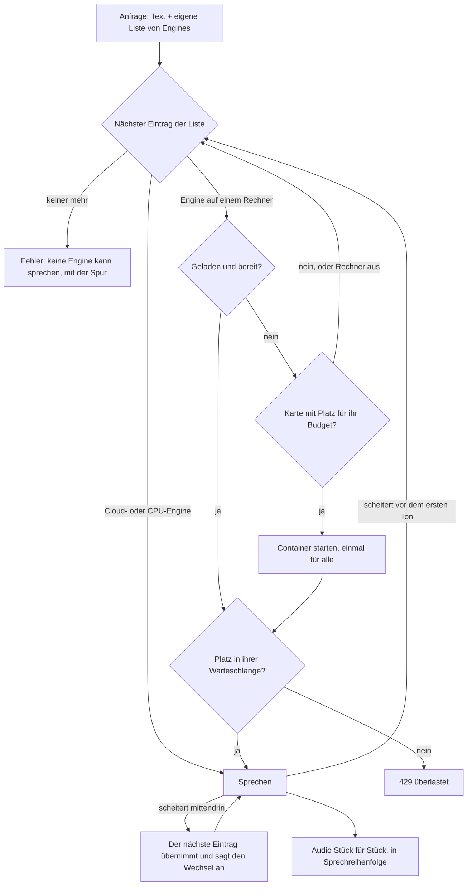

# TTS-Suite

[English](README.md)

Sprachausgabe (Text zu Sprache) als kleiner HTTP-Dienst, gebaut aus Engines, die als Module laufen:
Jede Engine ist ein Docker-Container (oder ein Cloud-Dienst), und eine Schnittstelle davor lässt jedes
Programm Text sprechen, ohne selbst Sprachausgabe zu bauen. Das Schwesterprojekt ist
[STT-Suite](https://github.com/Peuqui/STT-Suite) (Spracherkennung).

> **Stand: früh.** Die Engine-Schicht (aus [AIfred Intelligence](https://github.com/Peuqui/AIfred-Intelligence)
> übernommen, wo die Engines heute laufen) und der HTTP-Dienst sind geschrieben und gegen Attrappen getestet;
> ein Lauf mit echten Containern steht noch aus. Die Schnittstelle steht in
> [docs/INTERFACE.de.md](docs/INTERFACE.de.md).

## Idee

- **Engines sind Module.** Lokale Engines (zum Beispiel XTTS, Qwen3-TTS) laufen als Docker-Container, die
  man mit `docker compose` auswählt; Cloud-Engines (zum Beispiel Edge, DashScope) werden über das Internet
  gerufen. Man betreibt nur die, die man will.
- **Jede Anfrage bringt ihre eigene Liste.** Der Dienst bietet alle seine Engines an (ein Katalog: jede
  Engine auf jedem Rechner, auf dem sie laufen kann, und die Cloud). Eine Anfrage nennt die gewünschten Engines
  in Reihenfolge, mit Rechner und Textmenge auf einmal; der erste Eintrag, der sprechen kann, spricht, und fällt
  er aus, übernimmt der nächste. Keine Liste wird geteilt: Jeder Client hält seine eigene.
- **Kein Programm hängt von einem anderen ab.** Ein Client kennt nur die Adresse des Dienstes. Ohne den
  Dienst hat er seinen eigenen Ersatz (zum Beispiel die Stimme des Browsers).
- **Stimmen sind Dateien** in einem gemeinsamen Ordner, für jede Engine nur lesbar.

## Voraussetzungen

- Docker mit Compose; für lokale GPU-Engines eine NVIDIA-Grafikkarte mit dem NVIDIA Container Toolkit.

## Start

```bash
pip install .                                   # Python 3.12+
tts-suite token                                 # legt ~/.config/tts-suite/token an (nur für dich lesbar)
tts-suite serve --voices-dir ~/voices           # http://127.0.0.1:5090, Konfiguration in ~/.config/tts-suite/config.json
curl http://127.0.0.1:5090/health
```

Piper (lokal, ohne Grafikkarte) startet das Programm `piper` des Pakets `piper-tts`, das mit dem Dienst
installiert wird (groß: es bringt onnxruntime mit). Cloud-Engines brauchen ihre Schlüssel in der Umgebung, nie in der Konfiguration: lege sie in
`~/.config/tts-suite/env` (`DASHSCOPE_API_KEY=...`, nur für dich lesbar, `chmod 600`); der Dienst lädt diese
Datei.

Als Dienst deines Benutzers: `deploy/install.sh` legt eine venv an (mit dem Code dieses Klons, editierbar: die
Compose-Dateien der Engines liegen hier), verlinkt `tts-suite` nach `~/.local/bin` und installiert
`tts-suite.service`. Einmal `tts-suite serve --voices-dir <Ordner>` starten, damit die Konfiguration entsteht,
dann beenden und `systemctl --user enable --now tts-suite`. Wo andere Programme (eine Dienst-Seite, AIfred) den
Dienst starten und stoppen sollen, läuft er stattdessen als System-Unit `tts-suite@<Benutzer>`:
`sudo deploy/switch-to-system-unit.sh` (beendet zuerst die Benutzer-Unit; beide nutzen Port 5090).

Die Seite des Dienstes, `http://127.0.0.1:5090/ui/`, zeigt den Katalog (Zustand, Starten und Stoppen jeder Engine
auf jedem Rechner), bearbeitet die Konfiguration, listet die Stimmen (mit dem Abgleich einer Cloud-Engine) und
probiert ein Vorlesen mit einer eigenen Liste. Das Token wird einmal auf der Seite eingetragen, für alles, was
etwas ändert.

Solange der Dienst auf `127.0.0.1` lauscht, verlangen Sprechen und jedes `GET` nichts; ein Befehl, der etwas
ändert (`POST /config`, Container starten und stoppen, Stimmen hochladen), braucht immer das Token
(`X-TTS-Suite-Token: <Token>`). Auf einer anderen Adresse braucht alles eines, und der Dienst startet ohne
keines nicht (`--host`, `--token-file`). Die Rechner, die GPU-Regeln und die Vorgaben je Engine setzt man mit
`POST /config`; siehe die [Schnittstelle](docs/INTERFACE.de.md).

## Parallel arbeiten

Anfragen sind unabhängig und wiedereintrittsfähig: beliebig viele Programme können den Dienst gleichzeitig
aufrufen. Der Dienst besitzt die Container und die Karten, ein Programm sagt nur, was es will (seine eigene
Liste von Engines), den Rest erledigt der Dienst. Nichts wird doppelt geladen, und was gerade spricht, wird
niemandem weggenommen.



Was bei mehreren Programmen gleichzeitig passiert (Beispiele):

| Lage | Was der Dienst tut |
|---|---|
| Programm A will Qwen3 auf Rechner X, Programm B Qwen3 auf Rechner Y | Zwei Container auf zwei Rechnern, beide laufen nebeneinander. |
| A will Qwen3 auf dem Hauptrechner, B eine Cloud-Engine | Die Cloud braucht keine eigene Hardware, beide sprechen zugleich. |
| A und B wollen beide Qwen3 auf demselben Rechner | Ein Container, einmal gestartet. Die beiden wechseln sich ab (Qwen3 rendert eins nach dem anderen, das zweite wartet in der Warteschlange), nichts wird umgeladen. |
| Qwen3 läuft, B will XTTS auf demselben Rechner | Qwen3 bleibt unberührt. XTTS startet auf einer Karte mit Platz für sein Budget (bei mehreren Karten daneben). Hat keine Karte Platz, wird dieser Eintrag übersprungen (`no_vram`) und die Liste von B geht mit dem nächsten Eintrag weiter. |
| A und B fordern gleichzeitig dieselbe kalte Engine an | Ein Start, den beide teilen. Zwei Starts auf einem Rechner laufen nacheinander, sie wählen nie dieselbe Karte. |
| A liest, B will den Container loswerden (`POST /release`) | Der Container, der gerade spricht, wird nicht angefasst (`in_use`), alle anderen werden heruntergefahren. |

Grenzen: Ein Container nimmt `max_parallel` Lesungen zugleich und danach `max_queue` in der Warteschlange; darüber
antwortet der Dienst mit `429 überlastet`. Die Grenzen stellt man je Engine auf der Seite des Dienstes ein. Mit
mehr Rechnern wächst der Platz: Jeder Rechner mit einer GPU, den Rezepten (`docker/tts/`) und dem SSH-Schlüssel
des Dienstes kann eigene Engines tragen, und der Dienst schickt Lesungen an den Rechner, den die Liste des Clients
nennt. Eine Liste kann dieselbe Engine auf mehreren Rechnern in der gewünschten Reihenfolge nennen; der Dienst
verteilt die Last nicht von selbst, er nimmt den ersten Eintrag, der sprechen kann.

Ein Programm, das sich an bereits Geladenes hängen will, fragt den Katalog (`GET /engines`: Zustand `running` je
Engine und Rechner) und setzt die laufende lokale Engine an den Anfang seiner eigenen Liste.

## Lizenz

Kommt mit der ersten Veröffentlichung.
