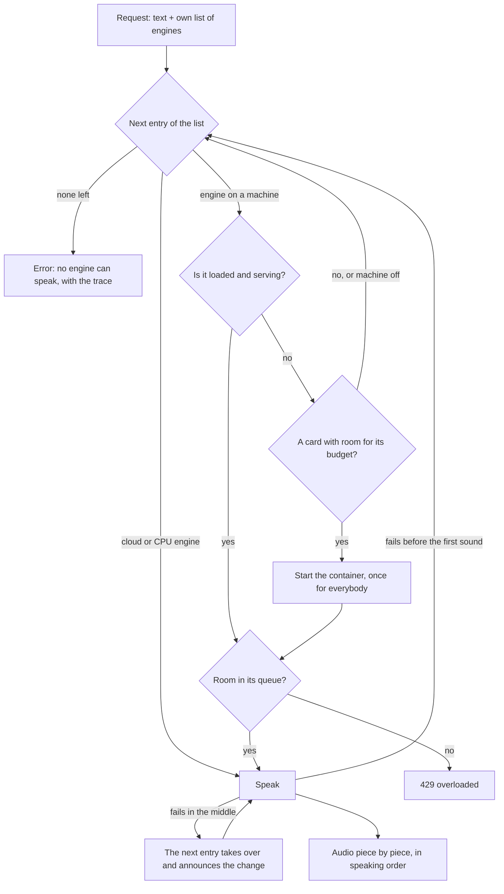

# TTS-Suite

[Deutsch](README.de.md)

Text-to-speech as a small HTTP service, built from engines that run as modules: each engine is a
Docker container (or a cloud service), and one interface in front of them lets any program have
text spoken without implementing speech output itself. The sister project is
[STT-Suite](https://github.com/Peuqui/STT-Suite) (speech recognition).

> **Status: early.** The engine layer (taken over from
> [AIfred Intelligence](https://github.com/Peuqui/AIfred-Intelligence), where the engines run today) and
> the HTTP service are written and tested against fakes; a run with real containers is still to come. The
> interface is in [docs/INTERFACE.md](docs/INTERFACE.md).

## Idea

- **Engines are modules.** Local engines (for example XTTS, Qwen3-TTS) run as Docker containers
  you choose with `docker compose`; cloud engines (for example Edge, DashScope) are called over
  the internet. You run only the ones you want.
- **Every request brings its own list.** The service offers all its engines (a catalog: each engine on
  each machine it can run on, and the cloud). A request names the engines it wants, in order, with the
  machine and how much text at once; the first entry that can speak does, and if it fails, the next
  takes over. No list is shared: every client keeps its own.
- **No program depends on another.** A client only knows the address of the service. Without the
  service it has its own fallback (the browser's voice, for example).
- **Voices are files** in one shared folder, read-only for every engine.

## Requirements

- Docker with Compose; for local GPU engines an NVIDIA GPU with the NVIDIA Container Toolkit.

## Start

```bash
pip install .                                   # Python 3.12+
tts-suite token                                 # makes ~/.config/tts-suite/token (readable for you alone)
tts-suite serve                                 # http://127.0.0.1:5090, configuration in ~/.config/tts-suite/config.json; voices: ./voices of the repository
curl http://127.0.0.1:5090/health
```

Examples of the configuration and of the private file with the keys: `deploy/config.example.json` and `deploy/env.example`.

Piper (local, without a GPU) runs the `piper` program of the package `piper-tts`, which is installed with the
service (large: it brings onnxruntime). Cloud engines need their keys in the environment, never in the configuration: put them into
`~/.config/tts-suite/env` (`DASHSCOPE_API_KEY=...`, readable for you alone, `chmod 600`); the service
loads that file.

As a service of your user: `deploy/install.sh` makes a venv (with the code of this clone, in editable form:
the compose files of the engines live here), links `tts-suite` into `~/.local/bin` and installs
`tts-suite.service`, then `deploy/install-engines.sh` asks which engines to set up: the Piper voices Thorsten and Ramona (download),
eSpeak (package `espeak-ng`) and, with an NVIDIA GPU, the Docker images of Qwen3-TTS and XTTS (their models download on the
first start); every question has an environment variable for unattended installs (listed in the script), and you can run the
script again later. Edge (cloud) and the browser voice need nothing. Once, run `tts-suite serve` (`--voices-dir <folder>` for another voices folder than `voices/` of the repository) so the configuration is written, stop
it, then `systemctl --user enable --now tts-suite`. On a machine where other programs (a service control page,
AIfred) must start and stop the service, run it as the system unit `tts-suite@<user>` instead:
`sudo deploy/switch-to-system-unit.sh` (it stops the user unit first; both use port 5090). It needs polkit
(Debian/Ubuntu: `polkitd`); without it the script stops before changing anything.

The page of the service, `http://127.0.0.1:5090/ui/`, shows the catalog (state, start and stop of each engine on each
machine), edits the configuration, lists the voices (with the sync of a cloud engine) and tries a reading with a list
of its own. Enter the token once on the page for what changes something.

While the service listens on `127.0.0.1`, speaking and every `GET` ask for nothing; a command that changes
something (`POST /config`, starting and stopping containers, uploading voices) always needs the token
(`X-TTS-Suite-Token: <token>`). On another address everything needs it, and the service does not start
without one (`--host`, `--token-file`). The hosts, the GPU rules and the defaults per engine are set with
`POST /config`; see the [interface](docs/INTERFACE.md).

## Working in parallel

Requests are independent and re-entrant: any number of programs can call the service at the same time. The
service owns the containers and the cards, so a program only says what it wants (its own list of engines)
and the service sees to the rest. Nothing is loaded twice, and nothing that speaks is taken away from it.



What happens with several programs at once (examples):

| Situation | What the service does |
|---|---|
| Program A wants Qwen3 on machine X, program B wants Qwen3 on machine Y | Two containers on two machines; both run side by side. |
| A wants Qwen3 on the main machine, B wants a cloud engine | The cloud needs no hardware of ours; both speak at once. |
| A and B both want Qwen3 on the same machine | One container, started once. The two take turns (Qwen3 renders one at a time, the second waits in the queue); nothing is reloaded. |
| Qwen3 runs, B wants XTTS on the same machine | Qwen3 is left alone. XTTS starts on a card that has room for its budget (several cards: next to it). If no card has room, that entry is skipped (`no_vram`) and B's list goes on with its next entry. |
| A and B ask for the same cold engine at once | One start, shared by both. Two starts on one machine are done one after the other, so they never pick the same card. |
| A reads, B wants the container gone (`POST /gpu/release`, `/release` for other hosts) | Without `force` the container that is speaking is not touched (`busy`); every other one is shut down. With `force` A's reading ends with `reading_aborted` and the reason. |

Limits: a container takes `max_parallel` readings at once and a queue of `max_queue` more; beyond that the
service answers `429 overloaded`. The limits are set per engine on the page of the service. With more
machines the room grows: every machine that has a GPU and the container recipes (`docker/tts/`) and the SSH key of
the service can carry its own engines, and the service sends readings to whichever machine the client's list
names. A list can name the same engine on several machines, in the order it prefers; the service does not spread
the load by itself, it takes the first entry that can speak.

Setting up another machine: it needs a copy of this repository (the recipes and `scripts/tts-host-ctl.sh`; the voices come
with it or are handed over by `POST /voices/push`, also the button in the voices tab), Docker, and the service's key pinned to
that script in `~/.ssh/authorized_keys` (the line is in the script's header). The script mounts the `voices/` folder next to it, so
the layout is the same on every machine.

A program that wants to hang on to what is already loaded asks the catalog (`GET /engines`: state `running` per
engine and machine) and puts the running local engine at the front of its own list.

## License

[PolyForm Noncommercial 1.0.0](LICENSE): free to download and use for any noncommercial purpose; commercial use needs the author's permission.
